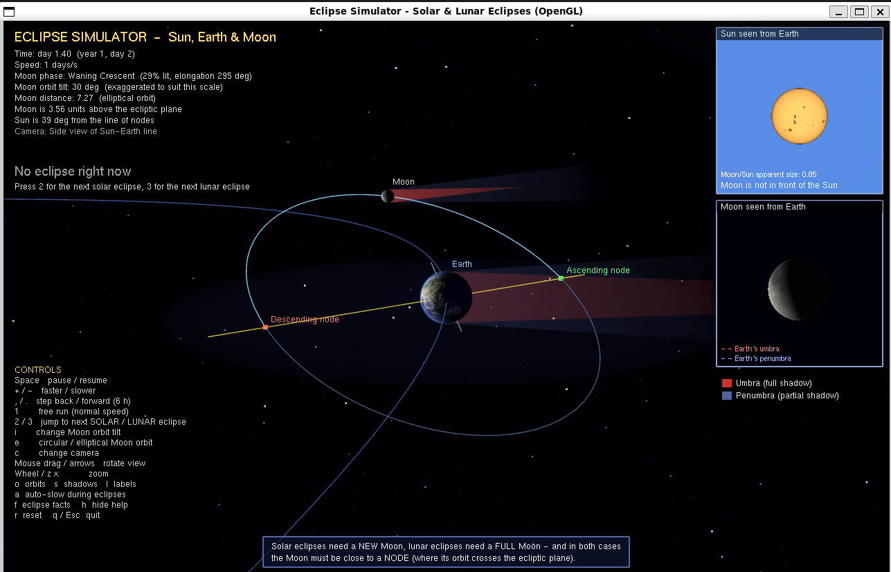
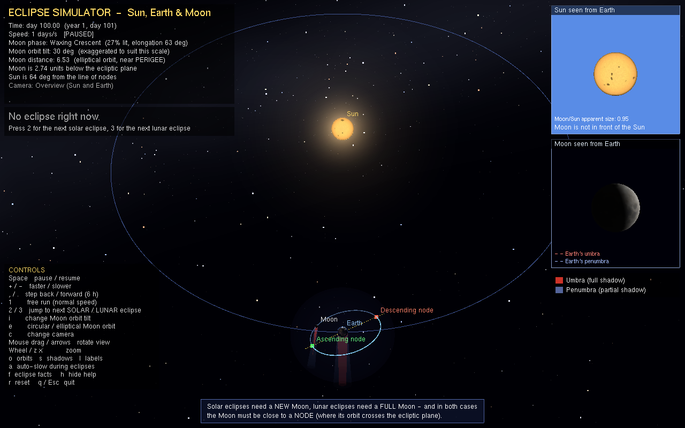
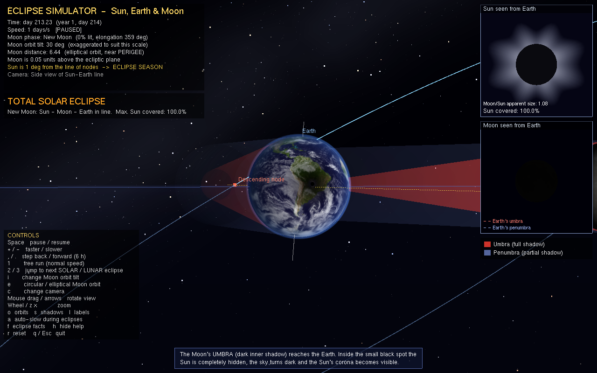
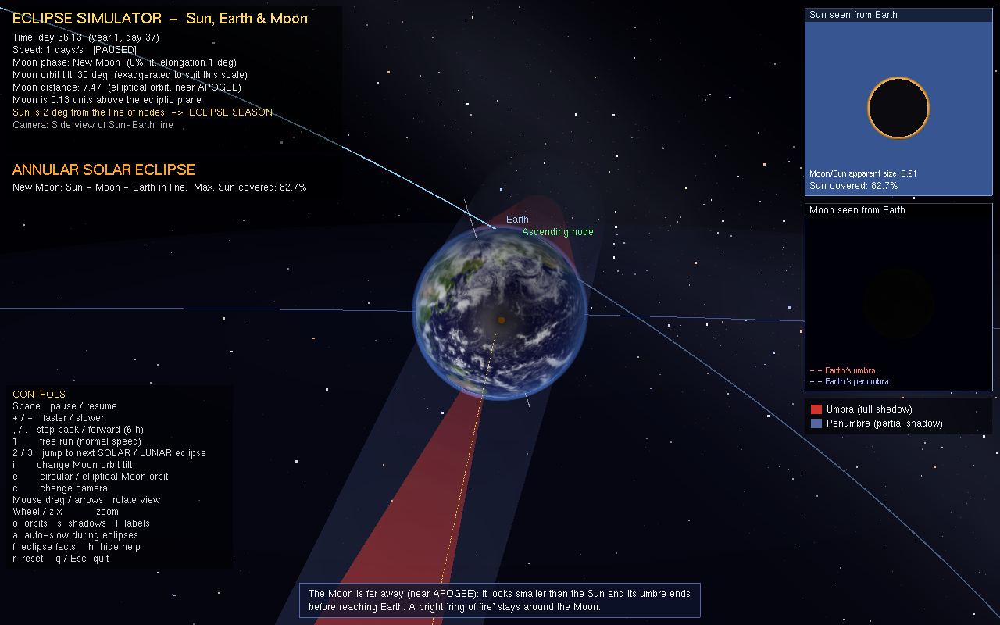
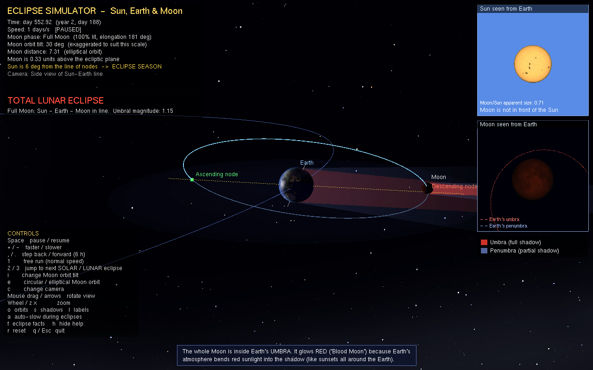

# Eclipse Simulator

An interactive 3D solar and lunar eclipse simulator built in C with OpenGL and GLUT. Explore the Sun–Earth–Moon system, follow eclipse shadows, and experiment with orbital tilt and shape.



## What you can explore

- **Solar eclipses:** partial, annular, and total.
- **Lunar eclipses:** penumbral, partial, and total.
- **Orbital geometry:** Moon orbit, orbital nodes, shadow cones, and eclipse alignment.
- **Simulation controls:** pause, change time speed, step through time, jump to the next eclipse, and change camera views.
- **Eclipse details:** live status and an optional facts panel.

## Screenshots

| Overview | Total solar eclipse |
|:---:|:---:|
|  |  |

| Annular eclipse | Total lunar eclipse |
|:---:|:---:|
|  |  |

## Requirements

- A C compiler (GCC or Clang)
- OpenGL and GLUT / FreeGLUT development libraries
- `make` (optional; used by the Makefile)

## Build

### Linux

On Debian or Ubuntu:

```sh
sudo apt install build-essential freeglut3-dev libglu1-mesa-dev
make
```

Or compile directly:

```sh
gcc -O2 -Wall -Wextra -std=c99 -o eclipse_sim eclipse_sim.c -lglut -lGLU -lGL -lm
```

### macOS

With Xcode Command Line Tools installed:

```sh
clang -O2 -o eclipse_sim eclipse_sim.c -framework OpenGL -framework GLUT -Wno-deprecated-declarations
```

### Windows

Using MinGW with FreeGLUT installed and available to the compiler:

```sh
gcc -O2 -o eclipse_sim.exe eclipse_sim.c -lfreeglut -lglu32 -lopengl32 -lm
```

## Run

Run the program from the project directory so it can find the `textures/` folder:

```sh
./eclipse_sim
```

On Windows, run `eclipse_sim.exe`. Examples:

```sh
./eclipse_sim --solar
./eclipse_sim --lunar --facts
./eclipse_sim --list 5
```

### Command-line options

| Option | Description |
| --- | --- |
| `--solar` | Start at the next solar eclipse. |
| `--lunar` | Start at the next lunar eclipse. |
| `--time DAYS` | Set the starting simulation time in days (applied before an eclipse jump). |
| `--advance DAYS` | Advance the simulation by the given number of days after the starting time or eclipse jump. |
| `--tilt N` | Set Moon orbit tilt: `0` = flat, `1` = 5.1°, `2` = 15°, `3` = 30° (default). |
| `--circular` | Use a circular Moon orbit instead of the default elliptical orbit. |
| `--camera N` | Set camera view: `0` = follow Earth, `1` = overview, `2` = side view (default). |
| `--paused` | Start with the simulation paused. |
| `--yaw X`, `--pitch X`, `--dist X` | Set camera yaw and pitch in degrees, and camera distance. |
| `--facts` | Show the eclipse facts panel. |
| `--list YEARS` | Print upcoming eclipses for the specified number of years and exit. |
| `--shot FILE.ppm` | Render one frame to a PPM image and exit. |

## Controls

| Input | Action |
| --- | --- |
| `Space` | Pause or resume. |
| `+` / `-` | Speed up / slow down simulation. |
| `1` | Resume at normal speed. |
| `,` / `.` | Step backward / forward by 6 hours. |
| `2` / `3` | Jump to the next solar / lunar eclipse. |
| `i` | Cycle Moon orbit tilt. |
| `e` | Toggle elliptical / circular Moon orbit. |
| `c` | Cycle camera views. |
| `o` / `s` | Toggle orbit lines / shadows. |
| `l` / `f` | Toggle labels / eclipse facts. |
| `a` | Toggle automatic slowing during eclipses. |
| `h` | Show or hide on-screen help. |
| `r` | Reset the simulation. |
| `z` / `x` | Zoom in / out. |
| Arrow keys or left mouse drag | Rotate the camera. |
| Page Up / Page Down, mouse wheel, or right mouse drag | Zoom. |
| `q` / `Esc` | Quit. |

## Project files

- `eclipse_sim.c` — simulator source.
- `stb_image.h` — image loader for PNG and JPEG textures.
- `textures/` — NASA Earth and Moon texture maps. Keep this folder alongside the executable; procedural colors are used if the textures cannot be loaded.
- `shots/v2/` — screenshots shown in the gallery.
- `image.png` — attached simulator output shown above.
- `Makefile` — Linux build and clean targets.

## Notes

This is an educational visualization, not a scale model. Body sizes and distances are compressed, and the Moon's orbit tilt is exaggerated by default so eclipse geometry is easier to see. Press `i` to cycle to the approximately real 5.1° tilt.

## Credits

- Earth day map, city lights, and clouds: NASA Visible Earth (Blue Marble).
- Moon surface: NASA Scientific Visualization Studio, CGI Moon Kit (LRO data).
- Sun surface, glow, and Milky Way: generated by the program.
